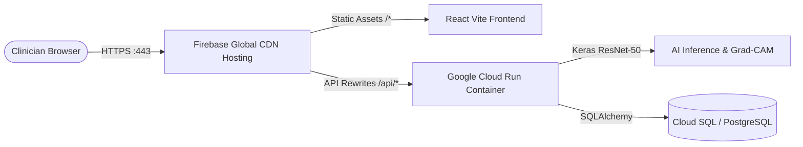

# DentalAI — Firebase & Cloud Run Deployment Guide

This guide details how to deploy DentalAI to **Firebase Hosting** (for the React Vite SPA) and **Google Cloud Run** (for the containerized FastAPI + ResNet-50 AI inference backend).



---

## 1. Architecture Overview

- **Frontend (Firebase Hosting):**  
  Deploys the optimized Vite production bundle (`frontend/dist`) across Firebase's global CDN with HTTPS, asset caching, and OWASP security headers.
- **Backend (Google Cloud Run via Firebase Rewrites):**  
  Runs the multi-stage Docker container (`backend/Dockerfile`) with Python 3.11, TensorFlow 2.16, Keras 3.0, OpenCV, and the 93.6 MB ResNet-50 neural network.
- **Unified Domain (Zero CORS):**  
  [`firebase.json`](file:///Users/dharshan/Desktop/dental/firebase.json) automatically proxies `/api/**` requests directly to the Cloud Run backend service, eliminating cross-origin complications.

---

## 2. Quick Deploy to Firebase Hosting

### Step 1: Login to Firebase
In your terminal, authenticate with your Google account:
```bash
npx --yes firebase-tools login
```

### Step 2: Set or Select Your Project
If you have an existing Firebase project:
```bash
npx --yes firebase-tools projects:list
npx --yes firebase-tools use <YOUR_FIREBASE_PROJECT_ID>
```
*(If you need to create a project, go to the [Firebase Console](https://console.firebase.google.com/) and click "Add Project".)*

### Step 3: Deploy Frontend
Run the automated deployment script:
```bash
./scripts/deploy_firebase.sh <YOUR_FIREBASE_PROJECT_ID>
```
Or manually:
```bash
cd frontend && npm run build && cd ..
npx --yes firebase-tools deploy --only hosting
```

Your web application will be live at:
`https://<YOUR_FIREBASE_PROJECT_ID>.web.app`

---

## 3. Deploying the Backend to Cloud Run (Connected to Firebase)

Because DentalAI uses a 93.6 MB pretrained Keras model and OpenCV C++ bindings, Google Cloud Run is the official and recommended backend for Firebase apps.

### Step 1: Deploy Backend Container
With the Google Cloud SDK (`gcloud`), run:
```bash
gcloud run deploy dentalai-backend \
    --source backend \
    --region us-central1 \
    --platform managed \
    --memory 2Gi \
    --cpu 2 \
    --allow-unauthenticated \
    --set-env-vars "DATABASE_URL=postgresql+psycopg2://<USER>:<PASS>@<CLOUD_SQL_IP>:5432/dentalai,JWT_SECRET_KEY=<YOUR_SECRET_KEY>"
```

### Step 2: Verify `firebase.json` Integration
The included [`firebase.json`](file:///Users/dharshan/Desktop/dental/firebase.json) already includes the Cloud Run rewrite:
```json
{
  "hosting": {
    "public": "frontend/dist",
    "rewrites": [
      {
        "source": "/api/**",
        "run": {
          "serviceId": "dentalai-backend",
          "region": "us-central1"
        }
      },
      {
        "source": "**",
        "destination": "/index.html"
      }
    ]
  }
}
```

Once deployed, any call to `https://<YOUR_PROJECT>.web.app/api/...` will automatically be routed to your Cloud Run microservice with full SSL termination and load balancing.

---

## 4. Continuous Deployment via GitHub Actions (Optional)

To enable automatic deployment on every push to `main`:
```bash
npx --yes firebase-tools init hosting:github
```
This generates `.github/workflows/firebase-hosting-merge.yml` and securely configures GitHub Secrets.

