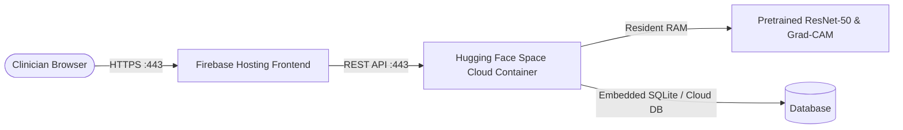

# 100% Free 24/7 Cloud Backend Deployment (Hugging Face Spaces)

This guide walks you through deploying the **DentalAI ResNet-50 Python Backend** to **Hugging Face Spaces** for **$0 forever** with **no credit card required**.



---

## Why Hugging Face Spaces?
- **Cost:** **$0 Forever**
- **Credit Card Required:** **None** (zero card needed)
- **Hardware Included:** **16 GB RAM + 2 vCPUs** (plenty for TensorFlow + ResNet-50)
- **SSL / HTTPS:** Free automatic HTTPS subdomain included.

---

## Step 1: Create a Free Space on Hugging Face

1. Sign up or log in at [https://huggingface.co](https://huggingface.co).
2. Go to [https://huggingface.co/new-space](https://huggingface.co/new-space).
3. Fill in the options:
   - **Space name:** `dentalai-backend` (or any name you prefer)
   - **License:** `MIT`
   - **Select the Space SDK:** Choose **Docker** (select **Blank**)
   - **Space Hardware:** Select **Free (CPU basic • 2 vCPU • 16 GB RAM)**
4. Click **Create Space**.

---

## Step 2: Get a Free Access Token for Git Push

1. Open [https://huggingface.co/settings/tokens](https://huggingface.co/settings/tokens).
2. Click **Create new token**.
3. Name: `deploy-dentalai`
4. Type: Select **Write**.
5. Copy the generated token (`hf_...`). *(You will paste this as your password when git pushes).*

---

## Step 3: Run the Automated Deploy Script

In your terminal at `/Users/dharshan/Desktop/dental`, run:

```bash
./scripts/deploy_huggingface.sh https://huggingface.co/spaces/<YOUR_USERNAME>/dentalai-backend
```
*(Replace `<YOUR_USERNAME>` with your Hugging Face username).*

When git prompts:
- **Username:** Your Hugging Face username
- **Password:** Paste your `hf_...` access token from Step 2.

This will upload the backend code, Docker configuration, and the 93.6 MB ResNet-50 neural network weights.

---

## Step 4: Verify Your Free Cloud API

In ~2 minutes, your Hugging Face Space will show **"Running"**.

Your permanent free cloud API URL will be:
```
https://<YOUR_USERNAME>-dentalai-backend.hf.space
```

You can test its health in your browser:
```
https://<YOUR_USERNAME>-dentalai-backend.hf.space/api/health
```

---

## Step 5: Connect Your Live Firebase Website

Run these two commands to point the live Firebase website ([https://dental-a94ff.web.app](https://dental-a94ff.web.app)) to your free cloud backend:

```bash
# 1. Save the Cloud API URL
echo "VITE_API_URL=https://<YOUR_USERNAME>-dentalai-backend.hf.space" > frontend/.env.production

# 2. Re-deploy the frontend to Firebase Hosting
cd frontend && npm run build && cd .. && firebase deploy --only hosting
```

Your live Firebase site is now fully connected to the cloud AI model 24/7 at **$0 cost**!

